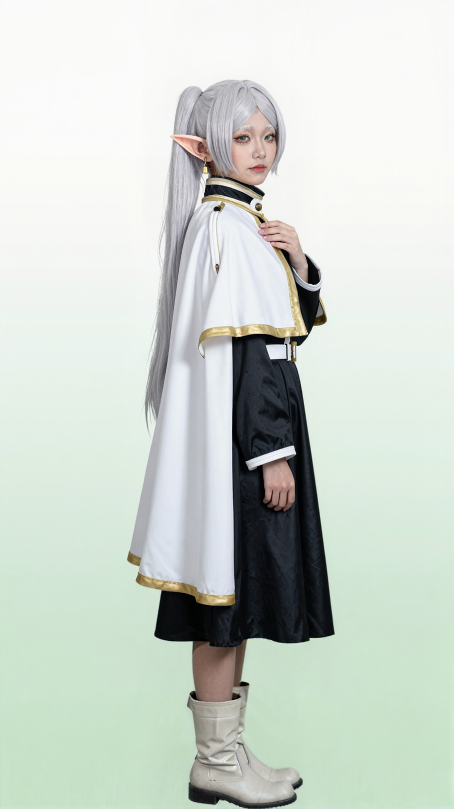
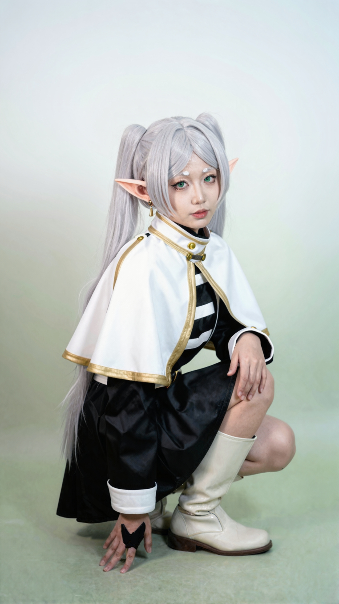
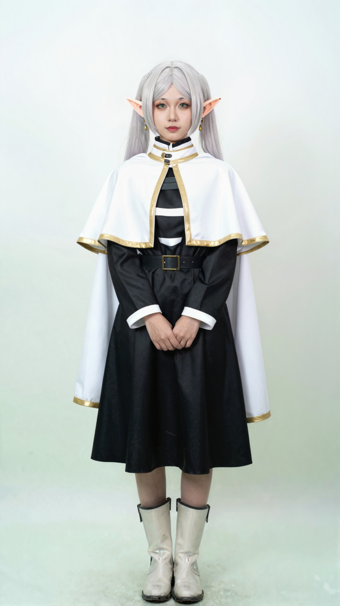
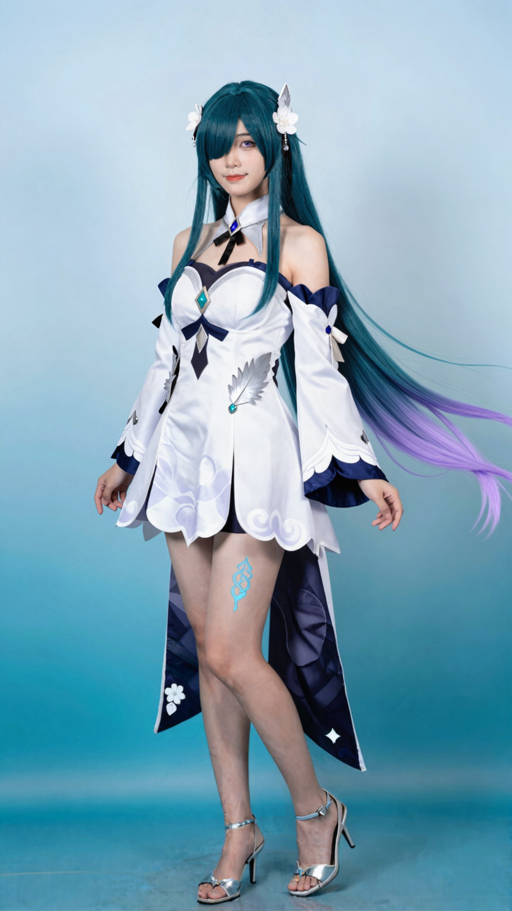
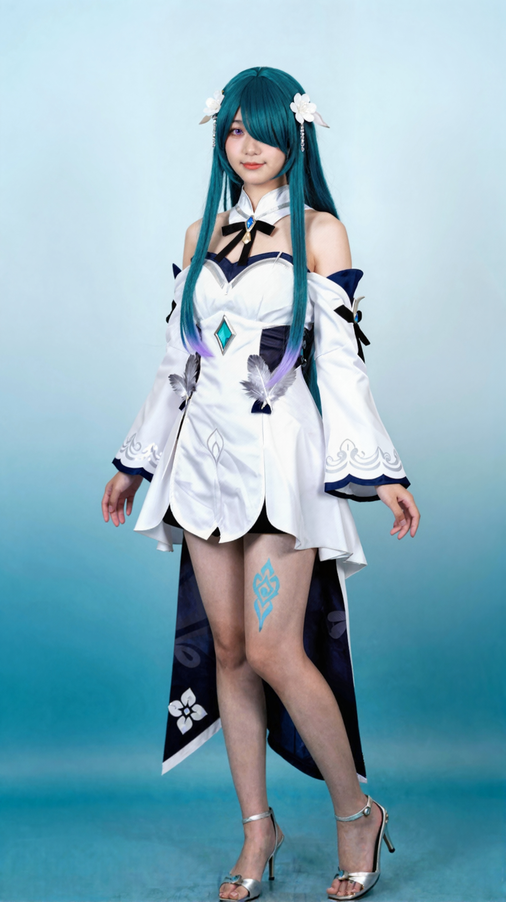
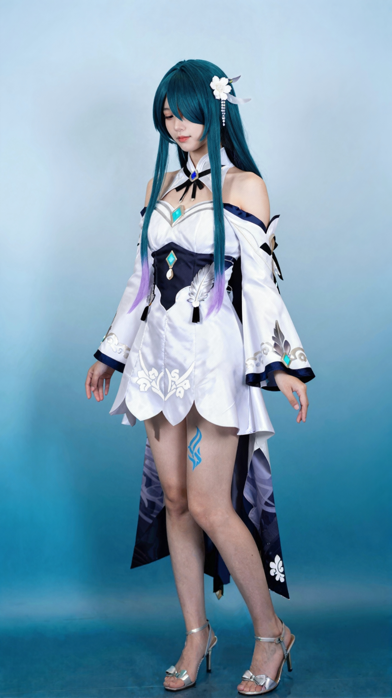

# Cosplay Studio（dsh-cosplay-studio）

把 `cosplay-photo-set` 技能 v2.1 的整套流程做成 DSH 插件：**输入角色名、上传一张参考图，或者什么都不给让插件推荐热门角色 → 真人 cosplay 套图**。

所有出图都在本机 ComfyUI（Z-Image-Turbo）上完成，图片不上传云端。

## 效果图

本机 ComfyUI + Z-Image-Turbo，1440×2560 成片（芙莉莲 / 芙宁娜）：

| | | |
| --- | --- | --- |
|  |  |  |
|  |  |  |

---

## 一、安装

### 方式 A：装进本机 DSH 桌面端（推荐）

1. 把整个 `dsh-cosplay-studio` 目录放进 profile 的 `node_modules`：

```
D:\DSH\profiles\desktop\node_modules\dsh-cosplay-studio
```

2. 编辑 `D:\DSH\profiles\desktop\package.json`：

```json
{
  "dependencies": {
    "dsh-cosplay-studio": "2.0.2"
  },
  "dsh": {
    "profile": {
      "bundles": ["...已有项...", "dsh-cosplay-studio"]
    }
  }
}
```

3. **完全退出并重新打开 DSH 桌面端**（关闭窗口通常只是隐藏，需要在托盘/任务栏退出应用），再刷新页面。侧边栏出现 **Cosplay 工作台** 图标；设置页也会出现 **Cosplay Studio** 一节。

### 方式 B：打包分发

```bash
pnpm pack          # 产出 dsh-cosplay-studio-2.0.2.tgz
```

把 `.tgz` 或整个目录发给别人；对方按方式 A 解压/放入 `node_modules` 并在 `package.json` 登记即可。发布到 npm 后可走插件市场安装。

### 方式 C：从 GitHub 安装（插件市场收录后）

仓库地址：<https://github.com/Wang-Shuanglin/dsh-cosplay-studio>

不打包、不构建也能装：GitHub Release 上有一份预构建的 `dsh-cosplay-studio.tgz`（不含截图，约 60 KB），下载后按方式 A 解压进 `node_modules` 即可。

```bash
# 下载最新预构建包
curl -L -o dsh-cosplay-studio.tgz \
  https://github.com/Wang-Shuanglin/dsh-cosplay-studio/releases/latest/download/dsh-cosplay-studio.tgz
```

解压后目录结构是 `package/`，把它重命名成 `dsh-cosplay-studio` 放进 profile 的 `node_modules`，再按方式 A 第 2、3 步登记并重启。

---

## 二、第一次使用：教程 → 同意 → 自动部署 → 自动调试

插件第一次打开时**不会直接开工**，而是先展示六章教程：

1. 这个插件做什么
2. 部署会装什么（ComfyUI + 三个模型）
3. 自动调试什么（模型能否加载、采样能否出图、显存是否够）
4. 硬件与时间（NVIDIA 8GB+；1152×2048 约 75 秒，1440×2560 约 4 分钟）
5. 两道人工闸门（基准图、镜头脚本）
6. 内容边界（一律 18 岁以上成人形象）

勾选同意后可以选择：

- **同意并开始部署**：自动定位/安装 ComfyUI、补齐模型、启动服务，并跑一次 640×1152 / 4 步自检（约 11 秒）。本机已装过 ComfyUI 与模型时只做复用与校验，不会重复下载。
- **仅同意，稍后手动部署**：只记录同意，不碰 ComfyUI。

部署与自检的结果、每一步日志、运行环境（ComfyUI 路径、Python、服务状态、显卡、模型是否齐全）都显示在「安装与设置」页。

---

## 三、工作台：三种入口

| 入口 | 做法 | 说明 |
| --- | --- | --- |
| A 角色名 | 输入角色名（可加作品名） | 配了对话模型时会联网式补全角色设定；没配就用内置模板 |
| B 参考图 | 上传一张二次元角色图 | 图是唯一设计依据，按图上服装配饰拆解 |
| C 随机推荐 | 点「随机推荐 3 个热门角色」/「换一批」 | 内置 28 个近年高热角色池；配了对话模型时会额外合并当季推荐 |

选定角色后点「创建项目」。

### 两道闸门

1. **基准图**：先生成 1152×2048 基准图。确认人物、服装、背景都对了，再点「确认基准图，进入镜头脚本」。未确认前不会出任何成片。
2. **镜头脚本**：生成 4–6 镜（每镜含情境/表情/动作/手/机位/道具），可逐镜改。确认后才会跑 1440×2560 成片。

### 出片与导出

成片按技能流程处理：**P7 去油光 → P7b 身体化妆（腿脚肤色统一）→ 导出 JPEG（≤1.95MB）**，并生成：

- `00_基准角色_<角色>.jpg`
- `00_全套预览.jpg`（2×2 拼图）
- `01_动作名.jpg`、`02_动作名.jpg` …
- `文案.txt`（标题 3 条 / 正文 / 标签）

---

## 四、设置页入口与侧边栏开关

- 设置页 `设置 → Cosplay Studio` 里可以：打开工作台、重新检测环境、启动/停止 ComfyUI、开关「侧边栏显示 Cosplay 工作台」、开关「成片自动做身体化妆」。
- 侧边栏图标被隐藏后，主面板依然存在，从设置页点「打开工作台」即可进入。

---

## 五、配置项（`<DSH_HOME>/data/dsh-cosplay-studio/config.json`）

| 键 | 默认 | 说明 |
| --- | --- | --- |
| `comfyDir` | 自动探测 | ComfyUI 目录 |
| `comfyPort` | 8188 | ComfyUI 端口 |
| `pythonExe` | 自动探测 | 运行 ComfyUI 的 Python |
| `baseSize` | `1152x2048` | 基准图尺寸 |
| `finalSize` | `1440x2560` | 成片尺寸 |
| `steps` / `cfg` / `shift` | 6 / 2 / 3 | 采样参数 |
| `vaeTileSize` / `vaeOverlap` | 1024 / 128 | 放大重绘的分块，避免背景接缝 |
| `deoil` | true | P7 去油光 |
| `bodyMakeup` | true | P7b 身体化妆 |
| `makeupStrength` / `legStrength` | 0.35 / 0.85 | P7b 强度（与技能脚本一致） |
| `llm.baseUrl` / `llm.apiKey` / `llm.model` | 空 | 可选：OpenAI 兼容对话模型，用于角色情报与镜头脚本 |
| `showSidebar` | true | 是否在侧边栏显示入口 |

---

## 六、已知限制

- 只支持 NVIDIA GPU（8GB 显存起步）；4K 会 OOM。
- 姿势、鞋、手套等细节在 6 步采样下仍可能漂移，插件不做自动视觉质检，需要逐镜改与重跑。
- 未配置对话模型时，角色卡与镜头脚本使用内置模板（姿势与镜头组合固定）。
- 背景渐变颜色刻意避开米/沙/驼等接近肤色的色系，否则 P7b 的肤色遮罩会把背景一起提亮。
